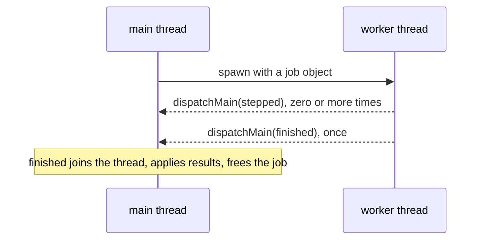
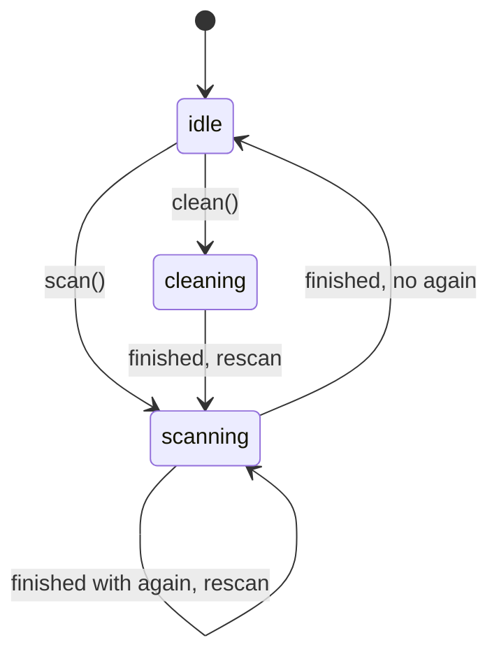

# State machines in nanokeep

## At a glance

nanokeep keeps its long-running work in a few implicit state machines: flags and optional pointers in `Cleaner`, `Inventory`, `App` and `fda.Guide`, moved by worker threads that report back on the main queue.
Four transitions could reach a bad state: removing an app during measuring crashed, a pick survived a list reload and could uninstall a different app, a scan asked for during a scan was dropped, and Command-R started a scan under the clean dialog.
Each now has a guard and a regression test. The states, the threads and the user flows stay as they were, and the open audit plans in `plans/` still cover four other risks.

This file describes the code at the working tree that holds these fixes, on top of `b83f7d8`.

## How the machines talk

Every machine follows one pattern. The main thread owns the state. A worker thread gets a private job object, does slow work, and posts a callback to the main queue with `objc.dispatchMain`. The main queue is serial and first-in, first-out, so callbacks from one worker run in the order that worker posted them. Only the main thread changes state, except for the atomic fields named below.

The general risk follows from this pattern. A job can hold data that the main thread changes while the job runs. A borrowed pointer, a list index or a "busy" guard is then out of date when the callback lands. Each finding below is one instance of that risk.

## 1. Cleaner: scan and clean jobs

Source: `src/cleaner.zig` (`Cleaner`, `Job`), driven by `src/view_clean.zig`, `src/view.zig` and `App.accessGranted` in `src/app.zig`.

### State

| Field | Meaning |
|---|---|
| `phase` | `idle`, `scanning` or `cleaning` |
| `job` | the job in flight, or null |
| `job.clean` | true for a clean job, false for a scan job |
| `applied` | how many categories the main thread took from the scan job |
| `cats[i].measured` | true when category `i` holds this scan's results |
| `scanned` | true when the last scan finished every category |
| `cancelled` | true when the user stopped the last scan |
| `again` | true when a scan was asked for while a job ran |
| `last` | the result of the last clean, until a toast shows it |
| `job.progress.stop` | atomic; the main thread sets it, the worker reads it |
| `job.done` | atomic; categories the worker finished |

The view derives a fifth, visible state: `found` is `idle` with `scanned`.

### Invariants

1. `phase == idle` if and only if `job == null`.
2. `phase == scanning` if and only if `job != null and !job.clean`. `phase == cleaning` if and only if `job != null and job.clean`.
3. `applied <= job.done <= specs.len`. `cats[i].measured` is true exactly for `i < applied`.
4. `scanned` implies `applied == specs.len`. A Cancel that lands after the worker finished every category leaves both `scanned` and `cancelled` true. That is harmless, because the results are complete.
5. Only one job exists at a time. A clean job always ends in a new scan.
6. `again` is false whenever `job == null`, except inside `complete`.

### Transitions

| From | Event | Guard | Action | To |
|---|---|---|---|---|
| idle | `scan()` | none | clear categories, `applied = 0`, `scanned = false`, `again = false`, spawn a scan job | scanning |
| scanning | `scan()` (Command-R, Full Disk Access granted) | none | set `progress.stop`, `again = true` | scanning |
| cleaning | `scan()` | none | `again = true`; the clean ends in a scan anyway | cleaning |
| scanning | `stepped` callback | none | move `job.lists[applied..done]` into `cats`, mark them measured, notify | scanning |
| scanning | `cancel()` | none | set `progress.stop`, `cancelled = true`, `again = false` | scanning |
| cleaning | `cancel()` | none | nothing | cleaning |
| scanning | `finished` callback | `again` | apply finished categories, free the job, `scan()` | scanning |
| scanning | `finished` callback | `!again` | apply finished categories; set `scanned` and swap in the folder cache only if all categories finished | idle |
| idle | `clean()` | none | copy the selected items into actions, spawn a clean job | cleaning |
| scanning, cleaning | `clean()` | none | ignored | same |
| cleaning | `finished` callback | none | `last = result`, notify (the toast shows), `scan()` | scanning |
| any | thread spawn fails | none | run the job on the main thread, then `complete` | idle or scanning |

The confirm dialog (`App.confirm_clean`) sits on top: the hero's Clean button opens it only in `found`, and its OK calls `clean()`. Command-R is ignored while any confirm dialog is open.

## 2. Inventory: the app list and its sizes

Source: `src/apps.zig` (`Inventory`, `Listing`, `Measure`), driven by `src/view_apps.zig` and `App.uninstallSelected`.

### State

| Field | Meaning |
|---|---|
| `listing` | the listing job in flight, or null |
| `measuring` | the size job in flight, or null |
| `loaded` | true after the first list arrived |
| `generation` | counts list changes: a new list or a removed app |
| `measuring.generation` | the generation the size job was started for |
| `measuring.paths` | the size job's own copies of the app paths |
| `apps[i].measured` | true when `apps[i].size` holds a measured size |

### Invariants

1. At most one of `listing` and `measuring` is set. `load()` refuses while either is set.
2. A size job's results apply only when `measuring.generation == generation`. Then `out.len == apps.len`.
3. A size job never reads memory that the list owns. It walks its own path copies.
4. Every change of `apps.items` order or length bumps `generation`.

### Transitions

| From | Event | Guard | Action | To |
|---|---|---|---|---|
| empty | `load()` | not listing or measuring | spawn a listing job | listing |
| listing | `listed` callback | none | replace `apps`, bump `generation`, `loaded = true`, start a size job | measuring |
| measuring | `remove(i)` (uninstall) | none | set the pool's cancel flag, bump `generation`, remove `apps[i]` | measuring (stale) |
| measuring | `measured` callback | generations match | copy sizes into `apps`, mark measured | idle |
| measuring (stale) | `measured` callback | generations differ | drop the results, start a new size job | measuring |
| idle | `remove(i)` | none | bump `generation`, remove `apps[i]` | idle |
| listing, measuring | `load()` (Reload) | none | ignored; the view disables Reload while measuring | same |

## 3. App selection and confirm dialogs

Source: `src/app.zig`, `src/view.zig`, `src/view_procs.zig`, `src/view_apps.zig`, `src/view_clean.zig`.

| Field | Meaning |
|---|---|
| `selected` | the picked process group, and its pid when a single process is picked |
| `app_selected` | the index of the picked app in `inventory.apps` |
| `app_selected_generation` | `inventory.generation` when the app was picked |
| `confirm_quit`, `confirm_uninstall`, `confirm_clean` | a confirm dialog is open |
| `force` | the quit dialog sends SIGKILL instead of SIGTERM |

Invariants:

1. `selectedApp()` returns an app only when no listing runs and `app_selected_generation == inventory.generation`. So an index always names the app the user picked.
2. A list change clears `app_selected` (`App.inventoryChanged`).
3. The uninstall dialog closes itself when `selectedApp()` is null.
4. Escape clears both selections only when no dialog is open. Command-R starts a scan only when no dialog is open.
5. `quitSelected()` and `uninstallSelected()` clear the selection after they act.

Process selection keeps a group key and a pid, not an index, so a new sample cannot point it at another row. The pids to quit are worked out when the user confirms.

## 4. Full Disk Access guide

Source: `src/fda.zig` (`Guide`), started by `App.requestAccess`.

| From | Event | Guard | Action | To |
|---|---|---|---|---|
| idle | `begin()` | access already granted | `grant()`: notify, no panel | granted |
| idle | `begin()` | not granted | open System Settings, build the panel, start a 0.5 s poll timer | guiding |
| guiding | `begin()` | not granted | bring the panel to the front | guiding |
| guiding | timer `poll()` | granted | stop the timer, notify, show "granted", close the panel after 1.5 s | granted |
| guiding | timer `poll()` | not granted | move the panel under System Settings | guiding |
| guiding | close button, `dismiss()` | none | stop the timer, release the panel | idle |
| granted | `begin()` | granted | notify again, no panel | granted |

Invariants: the timer runs only in `guiding`. `panel` and `controller` are both set or both null. The notification (`App.accessGranted`) shows a toast and calls `Cleaner.scan()`, which now restarts a scan that runs.

## 5. Smaller machines

| Machine | Source | States and rule |
|---|---|---|
| Sample cadence | `App.tick`, `App.heartbeat` | `last` is the time of the last sample. A visible window samples every 2 s, a hidden one every 10 s. After the first sample the second comes 0.6 s later, so CPU rates show sooner. `live = false` stops sampling. |
| Process cache | `procs.Sampler.lookUp`, `forget` | One `Known` entry per pid. An entry is reused only when the start time and UUID match, so a reused pid gets a new entry. Entries not seen in a sample are removed. |
| Mac name lookup | `machine.Machine.lookUpName` | Runs once: `thread == null` before, set after. The result lands on the main queue. |
| Thermometer | `iokit.Thermometer` | `started` once. The worker loops until `stop`; the stopper sets `stop` and signals under the mutex, so no wakeup is lost. |
| Usage ledger | `usage.Ledger` | `dirty` after a change. A save at most every 300 s, and at exit. A failed save keeps `dirty`. |
| Size pool | `walk.Pool` | Workers claim paths with an atomic counter, so each path is walked once. Either `cancel` or the shared `stop` flag ends the claims. |

## Findings

All four findings were reachable, and each is fixed with a test that failed before its fix. They are grouped by cause into two issues: F1 and F2 are [#9](https://github.com/fpcMotif/nanokeep/issues/9), where F1 is also [#8](https://github.com/fpcMotif/nanokeep/issues/8). F3 and F4 are [#10](https://github.com/fpcMotif/nanokeep/issues/10).

| # | Impact | Invalid state or transition | Evidence before the fix | Fix |
|---|---|---|---|---|
| F1 | Crash, or wrong sizes and use after free in a release build | `measured` paired a 2-app list with 3 results, because `remove` changed the list without bumping `generation`. Worker threads also read the freed path of the removed app. | The new test panicked with `for loop over objects with non-equal lengths` at `src/apps.zig:274`, called from `Measure.finished`. | The size job copies its paths. `remove` cancels it and bumps `generation`. A stale result starts a new size job (`src/apps.zig`, `startMeasure`, `measured`, `remove`). |
| F2 | The wrong app moves to the Trash | `app_selected` is an index. During a Reload the old list stays on screen, so the user can pick an app and open the uninstall dialog. When the new list arrives, the same index names another app, and the dialog's title and OK act on that app. | The new test picked Gamma during a Reload. `selectedApp()` returned it while the listing ran, and `uninstallSelected()` would trash it. After the new list arrived (Alpha, Beta, Gamma), the index named Beta. | `selectedApp()` returns null while a listing runs or when the generation changed. A list change clears the pick (`src/app.zig`). |
| F3 | Cleanup lies after Full Disk Access is granted | `App.accessGranted` shows "Looking through Installers and the Trash now" and calls `scan()`. A scan that runs made `scan()` a no-op, so categories stayed "denied". The "Allow Full Disk Access" button shows for a category as soon as it is measured, while later categories still scan. Command-R during a scan was dropped the same way. | The new test asked for a scan from the first `stepped` callback after it added a cache folder. The finished scan held 1 cache item, not 2. | `scan()` during a scan stops it and sets `again`. `complete` then starts a fresh scan. `cancel()` clears `again` (`src/cleaner.zig`). |
| F4 | A click on Clean does nothing, with no message | Command-R under the open clean dialog started a scan. The scan emptied the categories under the dialog, and OK then called `clean()` while a job ran, which `clean()` ignores. | `Tester.shortcut(Command-R)` returned true, and `Cleaner.started` changed while `confirm_clean` was true. | `keys()` takes Command-R only when no confirm dialog is open (`src/view.zig`). |

Regression tests in `src/tests.zig`:

| Test | Finding |
|---|---|
| `removing an app while sizes are still being measured keeps the list and the sizes in step` | F1 |
| `an app picked while the list reloads cannot be uninstalled, and the pick ends when the new list arrives` | F2 |
| `a scan asked for while one runs starts again when it ends, so what changed shows` | F3 |
| `Cancel also drops a scan that was asked for while one ran` | F3; it went red when `cancel()` kept `again` |
| `Command-R does not start a scan while the clean dialog asks` | F4 |

## Known risks not fixed here

| Risk | Where | Why it is not fixed here |
|---|---|---|
| Clean acts on the last scan however old it is, so an item that stopped qualifying is still removed. | `Cleaner.clean` | Plan 005 and issue #7 cover it. |
| A child killed by a signal reads as exit code 0, so a killed `git status` reads as a clean worktree. | `run.capture` | Plan 002 and issue #4 cover it. |
| Callbacks already queued when the app quits can run after `App.deinit` frees their job. | every `dispatchMain` and the guide's `dispatchAfter` | Not verified. It depends on whether nanoui drains the queue after `run()` returns. |
| `Guide.begin()` with access already granted notifies again, so a second toast and scan follow. | `src/fda.zig` `grant` | The button that calls it hides once the scan sees access, so a repeat needs a click in a short window. |
| A cancelled scan shows its finished categories, but the hero says "Scan to see what can be cleaned". | `view_clean.heroOf` | Display only. No action uses the partial results. |
| If `Cleaner.start` cannot allocate the job, the clean's action list leaks. | `src/cleaner.zig` `start` | Out of memory only. |
