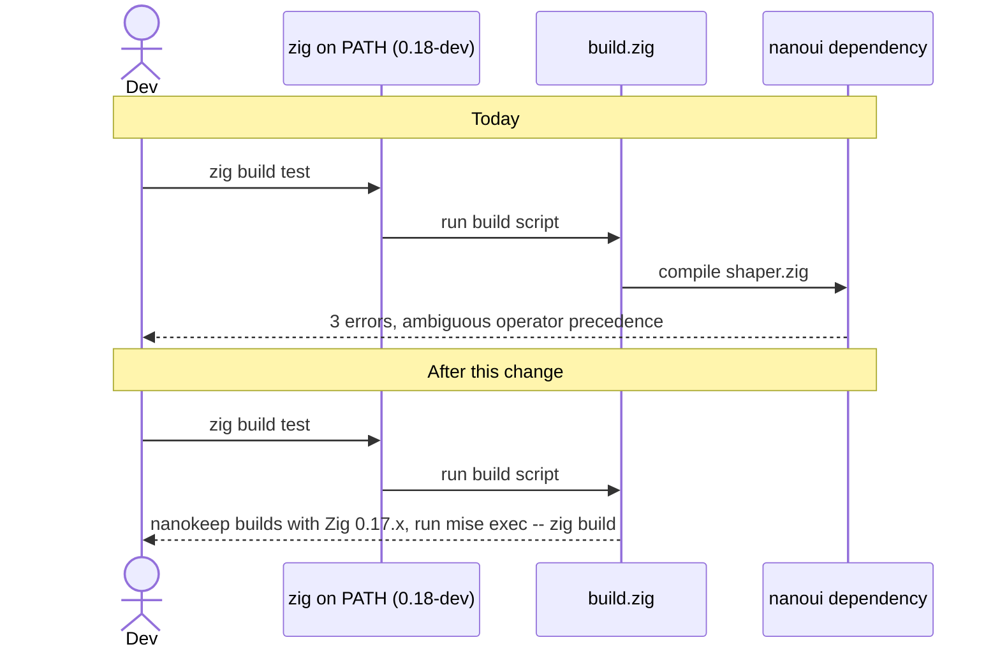

## At a glance

nanokeep builds only with Zig 0.17.x, but the repo does not pin that version, so a newer `zig` fails deep inside the nanoui dependency with no hint of the cause. This change pins Zig 0.17.0 with `mise.toml` and makes `build.zig` stop at once with a clear message on any other version. The dependency pin, the source code and the 59 existing tests stay unchanged.

## Problem Statement

I clone nanokeep and run `zig build test`. With Zig 0.18-dev on my PATH, the build fails with three compile errors in a dependency file I never touched ("ambiguous operator precedence"). Nothing tells me that my Zig version is the problem. Every other fix in this repo uses the test suite as its gate, so the gate has to work first.

## Solution

The repo names its toolchain. `mise exec -- zig build test` uses Zig 0.17.0 and passes. A different Zig fails in the first second with a message that says which version to use and how to run it.

## What happens today, and after

## User Stories

1. As a contributor, I want the repo to state its Zig version, so that I do not debug a dependency error that is really a toolchain mismatch.
2. As a contributor, I want one command that runs the tests with the right Zig, so that I can trust a red or green result.
3. As an agent executing another plan, I want a working test gate, so that I can verify my change.
4. As the maintainer, I want a wrong Zig to fail fast with a clear message, so that bug reports about build failures stop at the cause.

## Implementation Decisions

- Pin the toolchain with a `mise.toml` that lists Zig 0.17.0. mise is already how Zig 0.17.0 is installed on the maintainer's machine.
- Add a compile-time guard to the build script that rejects any Zig that is not 0.17.x and names the command to run.
- Keep `minimum_zig_version` and the nanoui pin as they are.

## Testing Decisions

- No new unit test. The gates are commands: the pinned Zig prints 0.17.0, the suite prints `59/59 tests passed`, and a non-0.17 Zig prints the guard message.
- Evidence at commit `b83f7d8`: the suite passes 59 of 59 on Zig 0.17.0 in about 75 seconds, and fails to compile on 0.18.0-dev.852.

## Out of Scope

- Fixing the nanoui fork so it compiles on Zig 0.18.
- A `zig fmt --check` gate. Seven source files already differ from `zig fmt` output, so a format pass must land alone, later.
- CI.

## Further Notes

The full step-by-step executor plan, with exact commands, done criteria and STOP conditions, is in the collapsed section below. It was written against commit `b83f7d8`.
