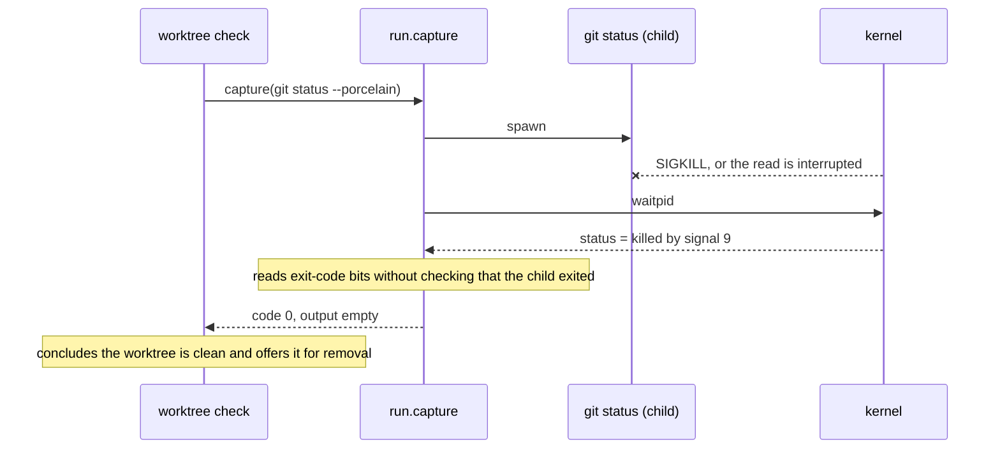
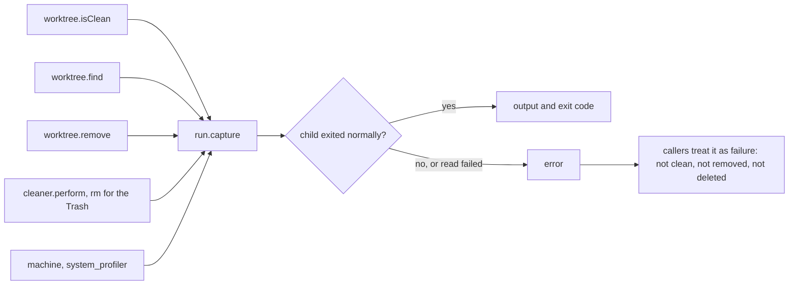

## At a glance

The process runner reports a child killed by a signal as exit code 0, and treats a failed read as the end of output, so a killed `git status` looks like "clean, no output". This change makes both cases return an error, which every caller already treats as failure. The runner's interface, its environment and all callers stay unchanged.

## Problem Statement

nanokeep decides whether a git worktree may be removed by running `git status` and checking that it exits 0 with no output. It empties the Trash by running `rm` and checking the exit code. When the child process is killed or the read is interrupted, nanokeep sees "exit 0, no output". A dirty worktree can then be offered for removal, and a killed `rm` is reported as a successful purge.

## Why it happens

A wait status encodes either an exit code or a signal number. The runner extracts the exit-code bits without first checking that the child exited. For a child killed by signal 9, those bits are 0. The read loop also stops on any non-positive result, so an error (`-1`) ends the output early without a trace.

## Solution

A killed child and a failed read are errors. Every caller already maps an error to the safe answer.

## User Stories

1. As a user, I want a worktree to be offered for removal only when git really reported it clean, so that an interrupted check cannot cost me work.
2. As a user, I want "deleted for good" to be reported only when `rm` really finished, so that the numbers I see are true.
3. As the maintainer, I want one process runner that fails loudly, so that every new caller inherits the safe behavior.
4. As a contributor, I want no leaked descriptor or zombie process on an error path, so that long sessions stay healthy.

## Implementation Decisions

- The runner retries a read that was interrupted, and returns an error for any other read failure.
- The runner retries an interrupted wait, and returns an error unless the child exited normally.
- The pipe is closed and the child is reaped before any error returns.
- No caller changes. All six call sites already map an error to failure.

## Testing Decisions

- Test external behavior only: what `capture` returns for a given child.
- New test, written first and seen to fail: a child that kills itself with `SIGKILL` gives an error instead of exit code 0.
- New characterization test: 200,000 bytes of output arrive whole.
- Prior art: the existing test "run captures a child's output and exit code".
- Interrupted reads cannot be forced in a unit test. Code review covers them.

## Out of Scope

- A timeout or a cancel flag for child processes. A hung `git` still blocks the cleanup scan. That needs its own design.
- Any change to the callers.

## Further Notes

Depends on the toolchain pin issue, because the test suite is the gate. The full executor plan is in the collapsed section below. It was written against commit `b83f7d8`.
