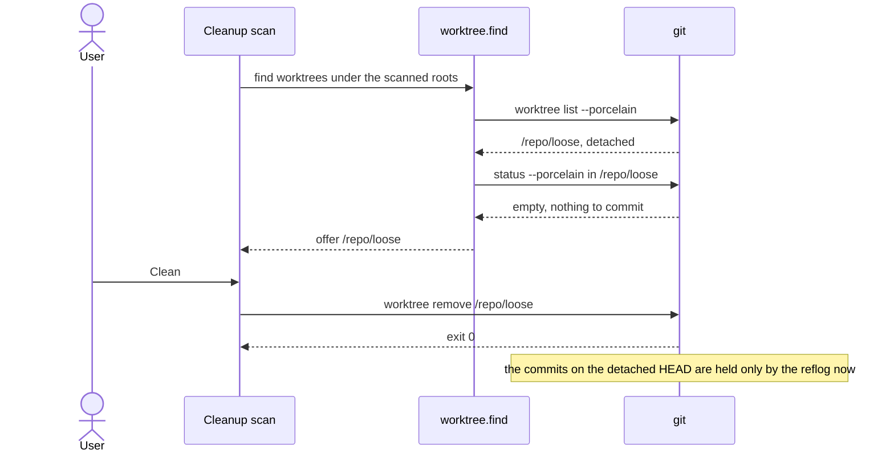
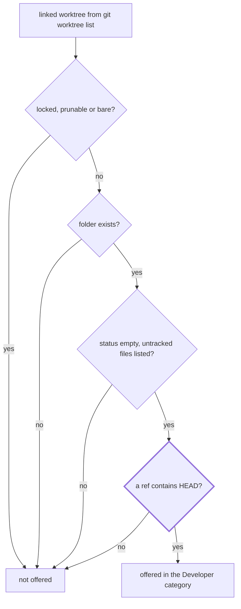

## At a glance

Cleanup offers a git worktree for removal when `git status` prints nothing, but that check misses commits on a detached HEAD that no branch or tag holds, and it can miss untracked files when the repo hides them from status. This change adds a "HEAD is held by a ref" check, forces untracked files to be listed, and corrects the UI text about ignored files. How worktrees are found and removed stays unchanged, and normal branch worktrees are still offered.

## Problem Statement

I select the Developer category in Cleanup. The note says "Git removes the worktrees; their branches and commits stay." One of my worktrees is on a detached HEAD with two commits I never put on a branch, which is how agent tools often leave them. nanokeep lists it as clean and removes it. My commits are now reachable only through the reflog. Files that git ignores, such as a local `.env`, are deleted too, and nothing told me.

## Why it happens

"Nothing to commit" and "nothing to lose" are different questions. `git status` answers the first. `git worktree remove` only refuses when tracked files are modified or untracked files exist. It does not check whether HEAD is reachable from a ref, and it deletes ignored files without a warning. Both facts were confirmed with git on 2026-11-10 in a scratch repo.

## Solution

A worktree is offered only when it is clean and its HEAD is held by a branch, tag or remote ref. The UI says that ignored files go with the worktree.

The last check is the new one.

## User Stories

1. As a developer, I want a detached worktree with commits that nothing else holds to be left alone, so that Cleanup cannot lose my work.
2. As a developer, I want a detached worktree whose commit is already on a branch to still be offered, so that leftover agent worktrees get cleaned.
3. As a developer who set `status.showUntrackedFiles=no`, I want untracked files to still count as work, so that the setting does not hide them from Cleanup.
4. As a user, I want the Developer note and the confirm dialog to say that ignored files are removed, so that I can decide with the facts.
5. As the maintainer, I want one function that answers "may this worktree be removed", so that the scan and any later recheck use the same rule.

## Implementation Decisions

- The worktree module gains one question, "is this worktree removable": clean status with untracked files forced on, and HEAD contained by at least one ref.
- Any git failure means "not removable".
- The scan uses that question instead of the status check alone.
- The Developer note and the confirm dialog text are corrected. The category description is unchanged.
- The removal command is unchanged.

## Testing Decisions

- Test through the public seam, `worktree.find`, on a real temp repo. That is how the existing worktree tests work.
- New tests, written first and seen to fail: a detached worktree with an unreferenced commit is not offered while a detached worktree at a referenced commit is, and a worktree with an untracked file is not offered when the repo hides untracked files.
- The two existing worktree tests must pass unchanged. They prove branch worktrees are still found and removed, and that the branch survives.

## Out of Scope

- Skipping worktrees that contain ignored files. That is a product decision for the maintainer. Options: skip them, show the ignored size, or keep the honest text.
- A minimum age for worktrees.
- Making worktree discovery faster or cancellable.

## Further Notes

Depends on the process-runner issue, because the new check trusts the runner's exit code. The full executor plan is in the collapsed section below. It was written against commit `b83f7d8`.
