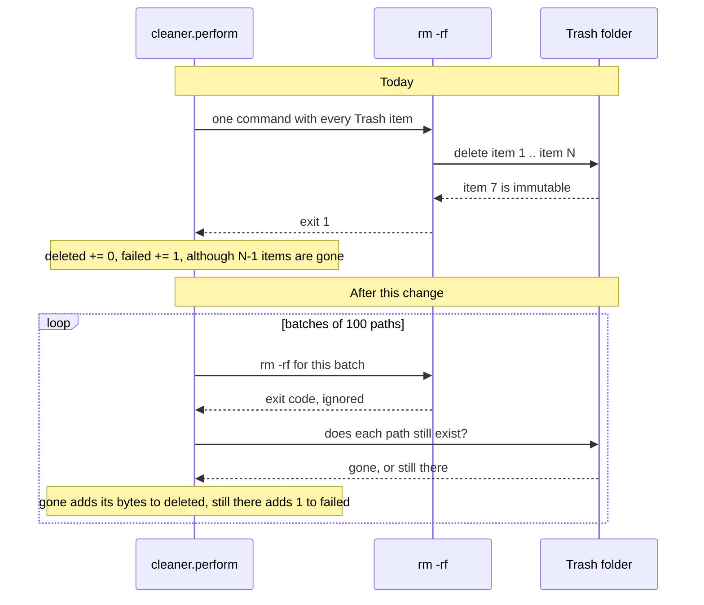

## At a glance

Emptying the Trash passes every item to one `rm -rf` command and trusts its single exit code, so one undeletable item makes nanokeep report 0 bytes deleted, and a very large Trash can exceed the argument size limit and delete nothing. This change deletes in batches of 100 paths and counts each item by whether it is really gone. Moving files to the Trash and removing worktrees stay unchanged.

## Problem Statement

I select the Trash category and click Clean. One item in my Trash is locked. nanokeep deletes everything else, then tells me "Cleaned, with some left" and reports nothing as removed for good, although gigabytes are gone. If my Trash held many thousands of items, nothing would be deleted at all and the message would be the same.

## Why it happens

One process, one exit code, many items. `rm` exits 1 when any single path fails, after it has deleted the others. nanokeep maps that one code to "all failed". The command line also has a size limit (about 1 MiB on macOS), and one command that names every item can exceed it. Confirmed on 2026-11-10: `rm -rf` on one deletable and one immutable item exits 1 and deletes the first.

## Solution

Deletion runs in batches, and the truth about each item comes from the file system, not from the exit code. Items dropped while the list is built are counted as failures instead of vanishing.

## User Stories

1. As a user, I want the "removed for good" figure to match what was really deleted, so that I can trust the result.
2. As a user with one locked item in the Trash, I want the rest to be deleted and counted, so that one item does not hide the result.
3. As a user with a very large Trash, I want it emptied, so that the size of the Trash never makes cleaning fail.
4. As a user, I want items with odd names (a leading dash, spaces) to be deleted like any other, so that a name can never change what the command does.
5. As the maintainer, I want an item that was skipped for lack of memory to count as a failure, so that a partial clean never reports full success.
6. As the maintainer, I want no crash on the delete path when memory is short, so that the app never dies in the middle of a destructive action.

## Implementation Decisions

- Permanent deletion is split into batches of 100 paths. Each batch is one `rm -rf --` call.
- After each batch, an item counts as deleted when its path no longer exists, and as failed otherwise. The exit code is not used.
- The failure count now means items, not command runs. The only consumer is a toast that checks whether it is above zero.
- While the action list is built, a failed copy skips the whole item and adds one to the failure count. An action marked as a worktree always carries its repo path.

## Testing Decisions

- Test through the public seam, the cleaner on a temp home folder, as the existing cleaning tests do.
- New test, written first and seen to fail: a Trash with two deletable items and one immutable item. The two are gone and their bytes are counted, and one failure is reported. One deletable item has a name that starts with `-rf` and contains spaces.
- New characterization test: 250 items, more than two batches, all deleted.
- The memory-failure paths have no test. Forcing them needs a failing allocator inside the cleaner.

## Out of Scope

- Rechecking items before they are deleted. A separate issue covers that.
- Showing per-item failures in the UI.

## Further Notes

Depends on the process-runner issue. The full executor plan is in the collapsed section below. It was written against commit `b83f7d8`.
