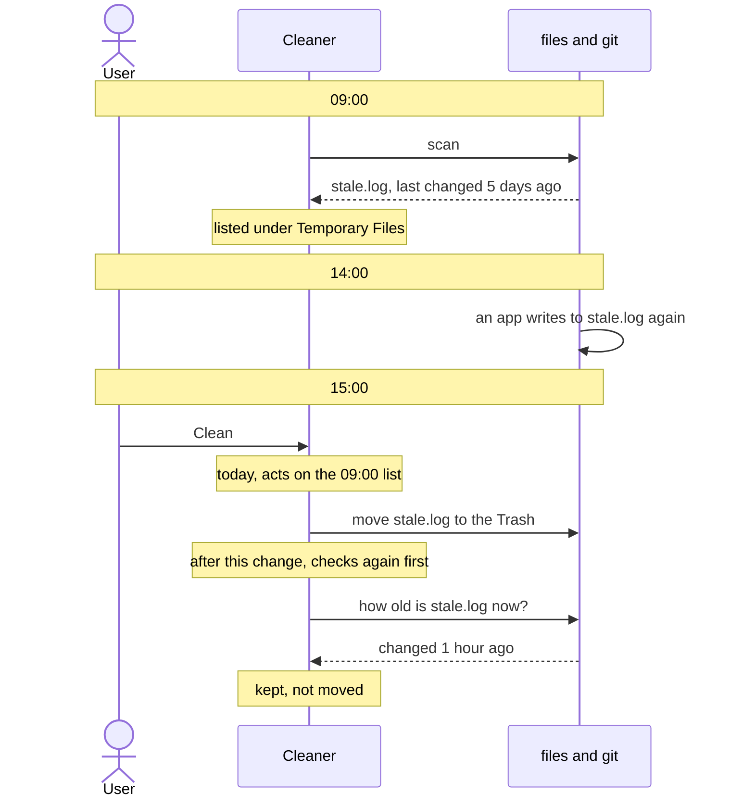
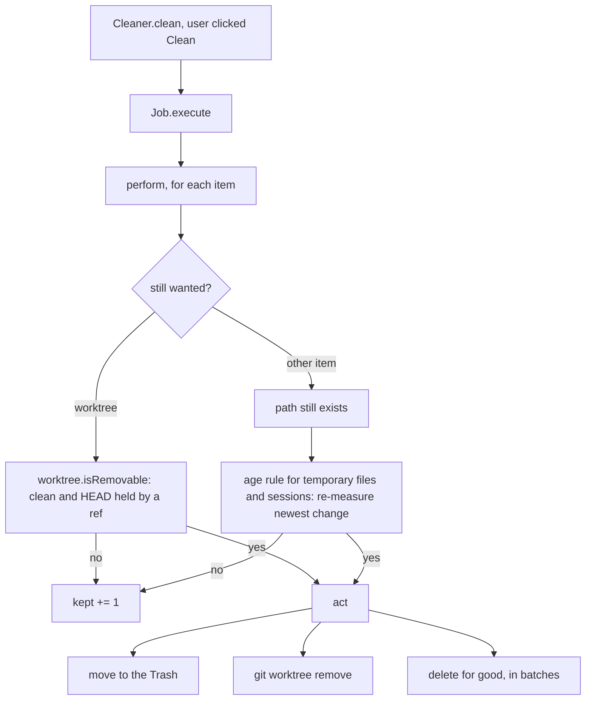

## At a glance

Cleanup acts on the last scan however old it is, so a file that was "unchanged for three days" at scan time is still moved to the Trash after it came back into use. This change rechecks every item at the moment of action and leaves alone anything that no longer qualifies. Scanning, selection and the confirm dialog stay unchanged.

## Problem Statement

I open nanokeep in the morning and it scans. In the afternoon I click Clean. Since the scan, an app has started writing to one of the "stale" temporary files again, I resumed an old agent session, and an agent committed work in a worktree that was clean. nanokeep moves or removes all three, because it works from the morning's list.

## Why it happens

The scan is a snapshot, and the rules ("unchanged for three days", "over a month old", "nothing to commit") are only true at the time of the snapshot. Clean builds its action list straight from that snapshot. Nothing between the click and the action looks at the item again.

## Solution

Every action passes one check immediately before it runs.

## User Stories

1. As a user, I want a temporary file that came back into use after the scan to be left alone, so that leaving the window open is safe.
2. As a user, I want an agent session I resumed after the scan to be kept, so that I do not lose a conversation I am using.
3. As a developer, I want a worktree that gained uncommitted or unreferenced work after the scan to be kept, so that an old scan cannot remove new work.
4. As a user, I want an item that no longer exists to be skipped quietly, so that I do not see "Cleaned, with some left" for something that is already gone.
5. As a user, I want items that still qualify to be cleaned exactly as before, so that the recheck costs me nothing.
6. As the maintainer, I want a count of kept items in the result, so that tests and a later UI message can use it.

## Implementation Decisions

- Each action carries the age rule of its category: three days for temporary files, thirty days for agent sessions, none for the rest.
- One function answers "is this item still wanted" just before the action: a worktree must still be removable, any other item must still exist, and an item with an age rule is measured again.
- The result gains a "kept" count. An item that fails the recheck is kept, not failed.
- The re-measure uses scratch memory outside the general allocator, as the scan does.
- A scan that is "too old" is not refused. The per-item recheck replaces that idea.

## Testing Decisions

- Test through the public seam, the cleaner on a temp home folder with a recording trash function, as the existing cleaning tests do.
- New tests, written first and seen to fail: of three old temporary files, one is touched and one is deleted after the scan, so only the third is trashed and two are kept with zero failures. A worktree that is detached and given an unreferenced commit after the scan is not removed.
- The existing cleaning tests must pass unchanged. They prove that items that still qualify are cleaned.

## Out of Scope

- Showing the kept count in the UI.
- A minimum age for worktrees, so that one an agent created minutes ago is not offered. That is a product decision.
- Faster or cancellable worktree discovery.

## Further Notes

Depends on the worktree-safety issue (it reuses the "removable" question) and on the Trash-batching issue (it builds on the same function). The full executor plan is in the collapsed section below. It was written against the code as those two issues leave it.
