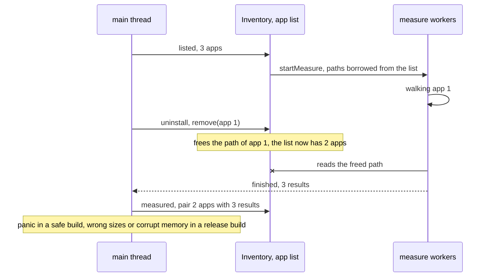
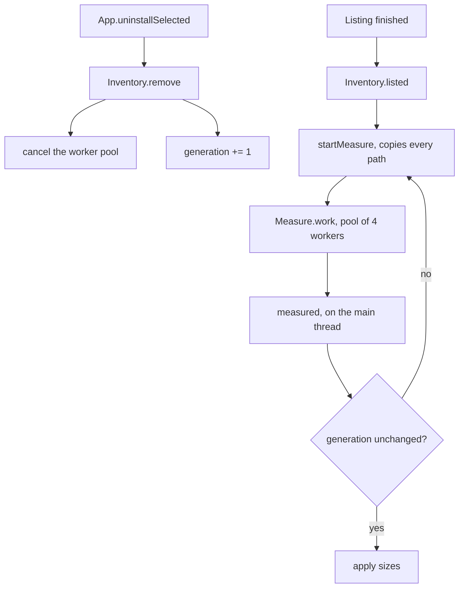

## At a glance

Background threads measure every app's size through path pointers borrowed from the app list, so uninstalling an app during that time frees memory the threads still read and leaves the results one entry longer than the list. This change gives the measurement its own copies of the paths and restarts it when an app is removed. Listing, sorting and the uninstall flow itself stay unchanged.

## Problem Statement

I open the Apps page right after launch, while sizes are still filling in, and uninstall an app. nanokeep can crash. If it does not crash, sizes can land on the wrong apps.

## Why it happens

Two owners, one piece of memory. The app list owns each path. The measurement borrows the same pointers and hands them to worker threads. Removing an app frees its path and shifts the list, while the measurement still holds the old pointers and a result array sized for the old list. When the workers finish, results and apps are paired by position, but the two no longer have the same length.

## Solution

The measurement owns copies of its paths. A removal cancels the running measurement and marks it stale. A stale measurement is thrown away and a new one starts.

## User Stories

1. As a user, I want to uninstall an app at any moment, so that the app never crashes because I was quick.
2. As a user, I want every remaining app to show its own size after an uninstall, so that the list stays true.
3. As a user, I want sizes to finish filling in after an uninstall without reopening the page, so that I do not notice the restart.
4. As the maintainer, I want the measurement to own its inputs, so that no later change to the list can reach into a running measurement.
5. As the maintainer, I want a deterministic test for this race, so that it cannot come back unnoticed.

## Implementation Decisions

- The measurement copies each app path when it starts and frees the copies when it ends. Every early exit frees them too.
- Removing an app cancels the worker pool and bumps the list's generation number.
- When a measurement finishes with an old generation, its results are dropped and a new measurement starts.
- The measurement record is freed only by the finish handler and by teardown, never by the removal, because a finish callback may already be queued.
- Trade-off accepted: a removal during measuring measures the remaining apps again. It costs one extra walk and keeps the code simple.

## Testing Decisions

- Test through the public seam, the app inventory, with real folders and the real worker threads.
- The race is made deterministic with the inventory's change callback. The list calls it on the main thread right after a measurement starts, and the test removes the first app at that moment.
- New test, written first and seen to fail: three fake apps, the first removed while measuring. The two that remain end up measured, each with the size `du` reports.
- Prior art: the test "the app list loads after the first frame, without blocking it", which uses the same run-loop spin.

## Out of Scope

- The uninstall flow in the app, and the walker pool itself.
- Callbacks that may still be queued at shutdown. Not verified, and not part of this bug.

## Further Notes

Depends only on the toolchain pin issue. The full executor plan is in the collapsed section below. It was written against commit `b83f7d8`.
